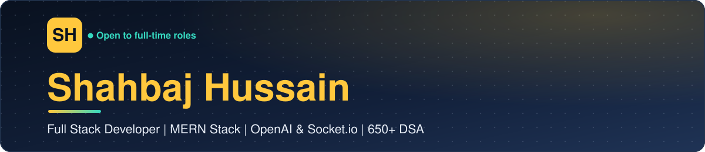

<!-- ═════════════ HERO BANNER ═════════════ -->

<!-- ═════════════ TYPING ANIMATION ═════════════ -->

  

<!-- ═════════════ LINKS ═════════════ -->

 

<!-- ═════════════ ABOUT ME ═════════════ -->
## About Me

I'm a **Full Stack Developer** who builds with the **MERN stack** (MongoDB, Express.js, React.js, Node.js) on top of a strong foundation in **Data Structures and Algorithms**. I design and deploy scalable **REST APIs**, **JWT-based authentication** and **role-based access control**, and I care about apps that are fast, maintainable and cloud-deployed.

<table>
  <tr>
    <td width="190" valign="top"><b>💼&nbsp; Experience</b></td>
    <td>
      <b>Full Stack Development Intern, Nayoda</b> (Remote, May 2026 to Jun 2026) 
      Built <b>SkillSphere</b>, an AI-powered freelance marketplace, with a Controller-Service-Repository backend.
    </td>
  </tr>
  <tr>
    <td valign="top"><b>🎓&nbsp; Education</b></td>
    <td>
      <b>B.Tech in Electronics and Communication Engineering</b> 
      Kalyani Government Engineering College (Aug 2023 to Jul 2027) &nbsp;|&nbsp; <b>CGPA 7.59</b>
    </td>
  </tr>
  <tr>
    <td valign="top"><b>🧠&nbsp; Problem solving</b></td>
    <td>
      <b>650+ DSA problems</b> solved, including <b>500+ on LeetCode</b>, plus GeeksforGeeks and Coding Ninjas. 
      Strong in <code>Graphs</code> <code>Dynamic Programming</code> <code>Trees</code> <code>Greedy</code>
    </td>
  </tr>
  <tr>
    <td valign="top"><b>🚀&nbsp; Shipped</b></td>
    <td>
      <b>4+ full-stack MERN apps</b> built independently and deployed to production, with <b>8+ active GitHub repositories</b> and well-documented code.
    </td>
  </tr>
  <tr>
    <td valign="top"><b>🔌&nbsp; Integrations</b></td>
    <td>
      <code>OpenAI API</code> <code>Razorpay</code> <code>Stripe</code> <code>Cloudinary</code> <code>ImageKit</code> <code>EmailJS</code> <code>Clerk Auth</code> <code>Inngest</code> <code>Socket.io</code>
    </td>
  </tr>
  <tr>
    <td valign="top"><b>🏗️&nbsp; Architecture</b></td>
    <td>
      <code>Controller-Service-Repository</code> <code>REST API design</code> <code>JWT access + refresh tokens</code> <code>RBAC</code> <code>OOP</code>
    </td>
  </tr>
  <tr>
    <td valign="top"><b>🗣️&nbsp; Languages</b></td>
    <td>Hindi (Advanced) &nbsp;|&nbsp; English (Intermediate)</td>
  </tr>
</table>

 

<!-- ═════════════ EXPERIENCE ═════════════ -->
## Experience

<table>
  <tr>
    <td width="190" valign="top">
      <b>Nayoda</b> 
      Full Stack Development Intern 
      Remote | May 2026 to Jun 2026
    </td>
    <td>
      <ul>
        <li>Completed a one-month internship building <b>SkillSphere</b>, a full-stack freelance marketplace, as the core project.</li>
        <li>Designed the backend with <b>Node.js, Express.js and MongoDB</b> using a clean <b>Controller-Service-Repository</b> architecture.</li>
        <li>Implemented <b>JWT authentication</b>, <b>role-based access control</b> and <b>OpenAI-powered</b> gig matching and proposal generation.</li>
        <li>Built <b>real-time chat with Socket.io</b> and a <b>milestone-based payment tracking</b> system.</li>
      </ul>
    </td>
  </tr>
</table>

 

<!-- ═════════════ PROJECTS ═════════════ -->
## Featured Projects

<table>
  <tr>
    <th width="190" align="left">Project</th>
    <th align="left">What it does</th>
    <th width="150" align="left">Links</th>
  </tr>

  <tr>
    <td valign="top">
      <b>SkillSphere</b> 
      AI-powered freelance marketplace
    </td>
    <td valign="top">
      Clients and freelancers connect for gig-based work. <b>OpenAI</b> matches gigs and writes proposals, <b>Socket.io</b> powers real-time chat, and payments are tracked by milestone. Includes access + refresh token auth, Client / Freelancer / Admin roles, reviews and ratings, and an admin dashboard. 
      <code>React.js</code> <code>Redux Toolkit</code> <code>Node.js</code> <code>Express.js</code> <code>MongoDB</code> <code>Socket.io</code> <code>OpenAI</code> <code>Cloudinary</code> <code>Joi</code>
    </td>
    <td valign="top">
      
    </td>
  </tr>

  <tr>
    <td valign="top">
      <b>Doctor Appointment System</b> 
      Patient portal, doctor panel, admin panel
    </td>
    <td valign="top">
      Three separate apps with role-based JWT auth (bcrypt hashing), real-time slot availability, booking and cancellation, <b>Razorpay</b> payments, plus admin and doctor dashboards for analytics and earnings. 
      <code>React.js</code> <code>Node.js</code> <code>Express.js</code> <code>MongoDB</code> <code>Razorpay</code> <code>Cloudinary</code> <code>Tailwind CSS</code>
    </td>
    <td valign="top">
      
      
    </td>
  </tr>

  <tr>
    <td valign="top">
      <b>AI Resume Builder</b> 
      Resumes written with OpenAI
    </td>
    <td valign="top">
      Dynamic resume forms, 15+ templates with 50+ color themes, AI-assisted content using the <b>OpenAI API</b>, real-time preview and PDF export. 
      <code>React.js</code> <code>Node.js</code> <code>MongoDB</code> <code>OpenAI</code> <code>ImageKit</code> <code>JWT</code>
    </td>
    <td valign="top">
      
      
    </td>
  </tr>

  <tr>
    <td valign="top">
      <b>Social Media App</b> 
      Chat, stories and profiles
    </td>
    <td valign="top">
      Real-time chat, image and video stories, likes, profile management, with <b>Clerk</b> authentication and Redux state management. 
      <code>React.js</code> <code>Node.js</code> <code>MongoDB</code> <code>Clerk</code> <code>Inngest</code> <code>ImageKit</code>
    </td>
    <td valign="top">
      
      
    </td>
  </tr>

  <tr>
    <td valign="top">
      <b>E-Commerce Platform</b> 
      Store, cart and payments
    </td>
    <td valign="top">
      Product search and filtering, cart and order management, <b>Stripe and Razorpay</b> payments with cash on delivery, an admin product dashboard and order tracking. 
      <code>React.js</code> <code>Node.js</code> <code>MongoDB</code> <code>Stripe</code> <code>Razorpay</code> <code>Cloudinary</code>
    </td>
    <td valign="top">
      
      
    </td>
  </tr>
</table>

 

<!-- ═════════════ TECH STACK ═════════════ -->
## Tech Stack

<table>
  <tr>
    <td width="190" valign="middle"><b>Frontend</b></td>
    <td></td>
  </tr>
  <tr>
    <td valign="middle"><b>Backend</b></td>
    <td>
       
      <code>REST API design</code> <code>JWT authentication</code> <code>Socket.io</code>
    </td>
  </tr>
  <tr>
    <td valign="middle"><b>Database</b></td>
    <td>
       
      <code>MongoDB</code> <code>Mongoose</code>
    </td>
  </tr>
  <tr>
    <td valign="middle"><b>Languages</b></td>
    <td></td>
  </tr>
  <tr>
    <td valign="middle"><b>Tools and deploy</b></td>
    <td>
       
      <code>MongoDB Compass</code>
    </td>
  </tr>
  <tr>
    <td valign="middle"><b>Concepts</b></td>
    <td>
      <code>Data Structures and Algorithms</code> <code>OOP</code> <code>API design</code> <code>Computer fundamentals</code>
    </td>
  </tr>
</table>

 

<!-- ═════════════ STATS ═════════════ -->
## GitHub and LeetCode Stats

 

 

 

<!-- ═════════════ ACHIEVEMENTS ═════════════ -->
## Achievements

<table>
  <tr>
    <td width="190" valign="top"><b>🏆&nbsp; Problem solving</b></td>
    <td>
      Solved <b>650+ DSA problems</b>, including <b>500+ on LeetCode</b> along with GeeksforGeeks and Coding Ninjas, strengthening proficiency in Graphs, Dynamic Programming, Trees and Greedy algorithms.
    </td>
  </tr>
  <tr>
    <td valign="top"><b>⚡&nbsp; Production apps</b></td>
    <td>
      Independently built and deployed <b>4+ full-stack MERN applications</b> to production and maintain <b>8+ active GitHub repositories</b> with well-documented codebases.
    </td>
  </tr>
</table>

 

<!-- ═════════════ CONTACT ═════════════ -->
## Let's Connect

I'm open to full-time roles, freelance work and collaborations.

<table>
  <tr>
    <td width="190"><b>📧&nbsp; Email</b></td>
    <td><a href="mailto:shahbajhussain231@gmail.com">shahbajhussain231@gmail.com</a></td>
  </tr>
  <tr>
    <td><b>📞&nbsp; Phone</b></td>
    <td><a href="tel:+918617719743">+91 8617719743</a></td>
  </tr>
  <tr>
    <td><b>💼&nbsp; LinkedIn</b></td>
    <td><a href="https://linkedin.com/in/shahbaj-hussain-9160443a8">linkedin.com/in/shahbaj-hussain-9160443a8</a></td>
  </tr>
  <tr>
    <td><b>🌐&nbsp; Portfolio</b></td>
    <td><a href="https://shahbaj-hussain-portfolio.netlify.app/">shahbaj-hussain-portfolio.netlify.app</a></td>
  </tr>
  <tr>
    <td><b>📍&nbsp; Location</b></td>
    <td>Kolkata, West Bengal, India</td>
  </tr>
</table>

 

